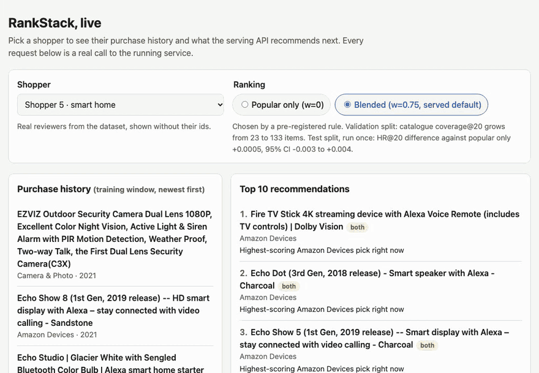
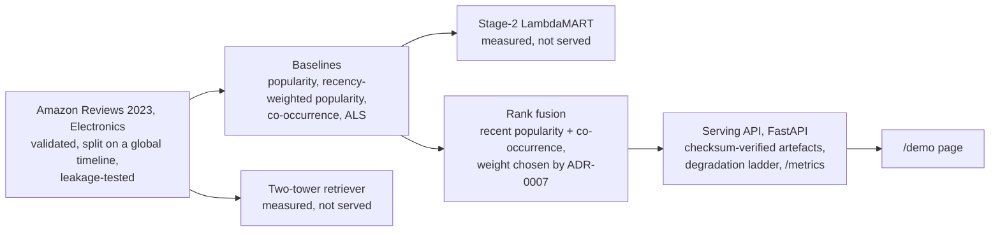

# RankStack

An online store has to decide, for every visitor and in a few milliseconds, which handful of a
million-plus products to show next. RankStack is a production-style recommender on Amazon's
Electronics reviews that does that end to end, from validated data to a served API, and measures
every component honestly, including the ones that lost.



The page above is the real service at `/demo`: pick a shopper, see what they bought and what the
API recommends next, flip between popularity alone and the served blend, or arrive as an anonymous
visitor. A hosted demo is planned; until then, run it locally (below) or watch the walkthrough attached
to the v1.0.0 release.

## Key results

Every figure is read by CI from the committed result file it names, so this table cannot drift from
what the code produces.

| Result | Measured | Command |
|---|---|---|
| Data after validation | 43,365,424 (`results/dataset_electronics_0core.json#/totals/interactions`) interactions over 1,610,012 (`results/dataset_electronics_0core.json#/totals/items_with_metadata`) items | `uv run python scripts/build_dataset.py --corpus electronics_0core` |
| Best baseline, recency-weighted popularity, warm-user HR@20 | 0.02395 (`results/evaluation_electronics_0core.json#/cohorts/warm_users/sources/popularity_recent/ranking/hr@20`) | `uv run python scripts/evaluate_baselines.py --corpus electronics_0core` |
| Two-tower retriever, warm-user HR@20 | 0.00025 (`results/evaluation_electronics_0core.json#/cohorts/warm_users/sources/two_tower/ranking/hr@20`) | `uv run python scripts/evaluate_baselines.py --corpus electronics_0core` |
| LambdaMART re-ranker against its own stage 1, paired HR@20 difference (95% CI) | -0.0148 (`results/two_stage_electronics_0core.json#/cohorts/warm_users/paired_two_stage_vs_stage_1/hr/hr@20/difference`) (-0.0172 (`results/two_stage_electronics_0core.json#/cohorts/warm_users/paired_two_stage_vs_stage_1/hr/hr@20/ci_low`) to -0.0125 (`results/two_stage_electronics_0core.json#/cohorts/warm_users/paired_two_stage_vs_stage_1/hr/hr@20/ci_high`)) | `uv run python scripts/evaluate_reranker.py --corpus electronics_0core --candidates 120 --cohort-size 20000 --resamples 1000` |
| Served blend against popularity alone, test split, paired HR@20 difference (95% CI) | +0.0005 (`results/fusion_weight_test_electronics_0core.json#/result/paired_hr@20_vs_popularity_recent/difference`) (-0.003 (`results/fusion_weight_test_electronics_0core.json#/result/paired_hr@20_vs_popularity_recent/ci_low`) to +0.004 (`results/fusion_weight_test_electronics_0core.json#/result/paired_hr@20_vs_popularity_recent/ci_high`)); catalogue coverage@20 23 (`results/fusion_weight_sweep_electronics_0core.json#/by_weight/0.0/coverage_at_20/items`) → 133 (`results/fusion_weight_sweep_electronics_0core.json#/by_weight/0.75/coverage_at_20/items`) items on validation | `uv run python scripts/select_fusion_weight.py confirm` |
| Serving latency, warm user, p50 / p99, median of three runs | 23.5 ms (`results/load_test_median_electronics_0core.json#/arrays/latency/warm/p50_ms`) / 35.9 ms (`results/load_test_median_electronics_0core.json#/arrays/latency/warm/p99_ms`) | `uv run python scripts/load_test.py --requests 400 --concurrency 8 --k 20`, three times, then `uv run python scripts/summarise_load_tests.py` |
| Stage-1 index for ALS: exact search p99, against the best approximate index's recall@200 | 3.8184 ms (`results/ann_index_electronics_0core_als.json#/curves/flat/0/p99_ms`), against 0.90175 (`results/ann_index_electronics_0core_als.json#/curves/hnsw/53/recall_at_top_k`) recall for HNSW, below the 0.95 target | `uv run python scripts/bench_ann_index.py --vectors als --queries 200` |

## Architecture



## Run it locally

```bash
uv sync --all-groups
uv run python scripts/download_data.py && uv run python scripts/build_dataset.py
uv run python scripts/train_baselines.py && uv run python scripts/build_serving_manifest.py
uv run python -m uvicorn rankstack.serving.app:app      # then open http://localhost:8000/demo
```

The first two steps download and validate the published dataset; the third trains the served models
and records their checksums, which the server verifies before it answers.

## Findings

- **The two-tower retriever failed.** Its training loss falls while its hit rate does not move, and it
  ends far below every baseline (table above). It is documented and diagnosed, not served.
- **Re-ranking hurt.** Stage 2 puts the right item in its candidate list often enough to help, then
  orders it worse than stage 1 did; the paired difference above excludes zero. Not served.
- **The business rules are unmeasurable at their shipped weights.** Warm-user HR@20 is
  0.00915 (`results/two_stage_model_only_electronics_0core.json#/cohorts/warm_users/stage_2/ranking/hr@20`)
  with the rules removed and
  0.00915 (`results/two_stage_electronics_0core.json#/cohorts/warm_users/stage_2/ranking/hr@20`)
  with them: they reorder the list only below the depth any hit rate looks at.
- **A cold-start privacy bug was found and fixed.** Unknown users were scored as the first encoded
  user, a real customer, so every anonymous visitor was shown items drawn from that customer's
  history. They now get the global ranking alone, and the tests check the list's contents, not just
  its status.
- **What is served was decided by a rule written before the results.** The co-occurrence weight was
  chosen on the validation split by a pre-registered rule
  ([ADR-0007](docs/adr/0007-serving-fusion-weight.md)) and confirmed once on the test split.

## Limitations

- **The served blend personalises shallowly.** At the selected weight, co-occurrence can reorder and
  promote items that popularity already ranks, but it cannot bring an item into a top 20 on its own;
  that needs a weight above 61/80. The range from there to equal weight is deferred to a future phase
  with a fresh, never-evaluated hold-out window, because the current test split has been used once.
- **The ANN recall ground truth counts items a user has already seen**, which the served list
  excludes; the bound on that effect is in the ANN section below.
- **Evaluation is offline only.** No online test has measured any of this on real traffic.
- **Some published prices are implausible** and are passed through as published (data notes below).
- **One process, no load shedding, no exported traces** ([runbook](docs/runbook.md#known-limits)).
  It is not hosted: the artefacts need more memory than most free tiers give.

## Documentation

- [Design document](docs/design.md) — requirements, SLOs, architecture, alternatives, risks, threat model
- [Architecture decisions](docs/adr/) — the decisions worth arguing about, and what was rejected
- [Data contracts](docs/schemas.md) — the Parquet schemas every later phase reads
- [Serving runbook](docs/runbook.md) — operating the API, every degradation and its alert
- [Changelog](CHANGELOG.md) — what each phase delivered
- Data: Amazon Reviews 2023 (McAuley Lab), Electronics. Terms analysis and mitigations in
  `docs/design.md` §4.3.

## What the pipeline does

```bash
uv sync --all-groups                                     # locked environment, Python 3.12
uv run python scripts/download_data.py                   # fetch + verify raw files (~2.3 GB)
uv run python scripts/build_dataset.py                   # validate, split, write Parquet + manifest
uv run pytest --cov=rankstack --cov-fail-under=85        # unit, property, integration, e2e
```

Raw dataset files are never committed (`data/` is gitignored, and CI fails if one is tracked). Every
build writes `data/processed/{corpus}/manifest.json` with source hashes, partition row counts,
validation outcomes, output hashes, seed, tool versions and platform, so a run can be repeated and
audited.

## Measured dataset statistics

Amazon Reviews 2023, Electronics, 0-core. Every figure below comes from
`results/dataset_electronics_0core.json`, which CI re-reads and compares against these numbers
(`scripts/check_docs_drift.py`).

| Quantity | Value | Source |
|---|---:|---|
| Interactions after validation | 43,365,424 | `results/dataset_electronics_0core.json#/totals/interactions` |
| Distinct users | 18,286,190 | `results/dataset_electronics_0core.json#/totals/users` |
| Distinct items with metadata | 1,610,012 | `results/dataset_electronics_0core.json#/totals/items_with_metadata` |
| Train rows (`timestamp < t1`) | 35,335,971 | `results/dataset_electronics_0core.json#/partitions/train/rows` |
| Validation rows (`t1 <= ts < t2`) | 3,953,788 | `results/dataset_electronics_0core.json#/partitions/valid/rows` |
| Test rows (`t2 <= ts`) | 4,075,665 | `results/dataset_electronics_0core.json#/partitions/test/rows` |
| Items present in train | 1,334,914 | `results/dataset_electronics_0core.json#/partitions/train/items` |
| Items first seen after `t1` | 274,946 | `results/dataset_electronics_0core.json#/cold_start/new_items` |
| Users first seen after `t1` | 2,845,057 | `results/dataset_electronics_0core.json#/cold_start/new_users` |
| Rows dropped by validation | 2 | `results/dataset_electronics_0core.json#/validation/rows_dropped` |
| Build wall-clock | 125 s | `results/dataset_electronics_0core.json#/elapsed_seconds` |

Reproduce with `uv run python scripts/build_dataset.py --corpus electronics_0core` on the platform
recorded in the result file's `environment` block. Download is a separate step
(`scripts/download_data.py`); both verify file sizes and record SHA-256 hashes. The build time above
is a warm run: the first run on a cold file cache, parsing the 1.31 GB metadata file, took 233 s on the
same machine.

### What validation found in the published data

Three findings, all recorded in the result file rather than smoothed over:

- **2 interactions rated `0.0`**, which is outside the documented 1–5 scale. Dropped and counted
  (`validation.checks[rating_out_of_scale]`). Two rows out of 43.4M cannot move any metric.
- **`price` is heterogeneous**: 526,449 numeric, 1,083,247 null, 316 strings — 266 of which are the
  em-dash placeholder `—` and the rest look like `from 9.95`. The reader takes the first number in a
  string price and never coerces a missing price to zero, because "unknown price" and "free" are
  different facts for a price-affinity feature.
- **Some published prices are implausible.** Of the
  1,372 (`results/catalogue_prices_electronics_0core.json#/priced`) priced Amazon Devices items,
  1,372 (`results/catalogue_prices_electronics_0core.json#/priced_below_threshold`) are listed under
  one dollar; the Echo Dot (2nd Generation) is at
  $0.99 (`results/catalogue_prices_electronics_0core.json#/examples/B01K8B8YA8/price`). The API
  returns prices as published; the demo page does not show them
  (`uv run python scripts/audit_catalogue_prices.py`).
- **128,442 items have no category path** and 106,334 have no `main_category`. Category affinity
  treats those as unknown rather than as a bucket of their own.

The pipeline also cross-checks its split against the publisher's published split sizes, which it
re-derives rather than trusting: 35,335,971 measured against 35,300,000 published for train,
3,953,788 against 4,000,000 for validation, 4,075,665 against 4,100,000 for test — all inside the 2%
tolerance that three-significant-figure rounding requires.
## Measured model results

Every baseline and the two-tower are scored by the same harness on the same frozen cohorts, with
exact full-catalogue ranking (no sampled negatives). One held-out target per user, ties broken by
ascending item code, already-seen items excluded from the candidate set. Numbers come from
`results/evaluation_electronics_0core.json`.

HR@20, left: all test users (n=11,585, includes 57% with no train history and 41% whose target is an
item unseen at training time). Right: warm users only (n=20,000, at least two train interactions and
a target that existed at training time) — the cohort where collaborative models are comparable.

| Source | HR@20 (warm) | HR@20 (all) | Served (all) | Coverage@50 (warm) | Figure |
|---|---|---|---|---|---|
| `popularity` | 0.0069 | 0.006733 | 1.0 | 0.000043 | `results/evaluation_electronics_0core.json#/cohorts/warm_users/sources/popularity/ranking/hr@20` |
| `popularity_recent` | **0.02395** | 0.016055 | 1.0 | 0.000041 | `results/evaluation_electronics_0core.json#/cohorts/warm_users/sources/popularity_recent/ranking/hr@20` |
| `cooccurrence` | 0.00295 | 0.001985 | 1.0 | 0.339083 | `results/evaluation_electronics_0core.json#/cohorts/warm_users/sources/cooccurrence/ranking/hr@20` |
| `als` | 0.00525 | 0.00587 | 0.914631 | 0.001101 | `results/evaluation_electronics_0core.json#/cohorts/warm_users/sources/als/ranking/hr@20` |
| `two_tower` | 0.00025 | 0.000604 | 1.0 | 0.492985 | `results/evaluation_electronics_0core.json#/cohorts/warm_users/sources/two_tower/ranking/hr@20` |
| `two_tower_no_logq` | 0.00005 | 0.000604 | 1.0 | 0.511973 | `results/evaluation_electronics_0core.json#/cohorts/warm_users/sources/two_tower_no_logq/ranking/hr@20` |

The Figure column carries a machine-checked pointer into the result file for the warm-cohort
HR@20, so CI fails if this table drifts. The remaining columns are supporting context read from
the same file.

Paired bootstrap over 1,000 resamples, against `popularity_recent`, warm cohort, HR@20:
`als` -0.0187 (CI -0.0208, -0.0166), `two_tower` -0.0237 (CI -0.0259, -0.0215). Every difference
excludes zero, so **nothing learned here beats recency-weighted popularity on this corpus**, which is
the result worth stating plainly rather than burying.

### The two-tower does not work yet

The two-tower underperforms every baseline by roughly an order of magnitude, and the diagnosis
(`scripts/diagnose_two_tower.py`, results in `results/two_tower_diagnosis_electronics_0core.json`)
shows why it is not simply undertrained: on a 400,000-user subsample the training loss falls from
9.82 to 1.63 while HR@20 does not move at all (0.0055 at both 1 and 6 epochs). The sampled-softmax
objective is being minimised without improving the global ranking, which points at the negative
sampling budget — 4,096 in-batch negatives against a 1.33M-item catalogue — rather than at the
architecture or the number of epochs.

What is *not* established, and would be the next thing to measure: whether a larger negative budget,
a sequence encoder in the user tower, or an item-side text tower closes the gap. Phase 3 deliberately
records the negative result and the diagnosis rather than tuning until one configuration wins.

Two defects were found by this measurement and are fixed, with regression tests:

- `gini` returned 0.889 for a uniform distribution (wrong discrete formula).
- `exact_rank` counted ties against a *filtered* score vector, misaligning values with item codes, so
  any source with masked items produced wrong ranks.

### Stage 1 ANN index: exact search is the recommendation for ALS

```bash
uv run python scripts/bench_ann_index.py --vectors als --queries 200
uv run python scripts/bench_ann_index.py --vectors als --queries 200 --raw-inner-product
uv run python scripts/bench_ann_index.py --vectors two_tower --queries 200
# diagnostics added to the same files without re-running the sweep (same flags + --diagnostics-only):
uv run python scripts/bench_ann_index.py --vectors als --queries 200 --diagnostics-only
```

Results: `results/ann_index_electronics_0core_{als,als_raw_ip,two_tower}.json`. Apple M5, 10 logical
CPUs, 16 GiB, macOS 26.6.2, Python 3.12.13, faiss 1.15.1, 2026-11-04, seed in the file. Every
latency is one query per `search` call (batch size 1) over 200 sampled users. Approximate indexes run
at faiss's default 10 threads (`omp_get_max_threads`).

The memory column is the **peak RSS growth during load (macOS)**: how much a fresh process's peak
resident memory rises while it loads the index file. Because it is a peak, it includes transient
load-time buffers. For IVF-PQ in particular it may overstate steady-state memory; for example, the
m32, nlist 4096 index below is 47.5 MiB on disk but shows 176.5 MiB here.

**Recall@200 is the target**, because design §6.3 defines a retriever's contract as recovering the
exact top-200. That is one source's share of the candidate list the ranker scores, and the ranker
can only reorder what retrieval returns. The bar is ≥ 0.95, against exact inner-product search on
the original vectors.

**No approximate index meets the 0.95 target.** Exact search does by construction, at 3.8 ms p99
with one thread, which is about 15% of the 25 ms retrieval budget (§3.3). At 1.2M ALS items,
**exact `IndexFlatIP` is the recommended retrieval index**. This recommendation covers ALS only.

| ALS exact search (`IndexFlatIP`, 32 dims, 1,217,903 items) | p99 ms | p50 ms | Peak RSS growth during load (macOS), MiB | Figure |
|---|---|---|---|---|
| 1 thread: the per-request figure under concurrency | 3.8184 | 2.7225 | 148.9 | `results/ann_index_electronics_0core_als.json#/curves/flat/0/p99_ms` |
| 10 threads: the single-request best case | 3.7434 | 2.4949 | 148.9 | `results/ann_index_electronics_0core_als.json#/curves/flat/1/p99_ms` |
| 1 thread, same index measured in the ablation run | 4.5217 | – | 148.9 | `results/ann_index_electronics_0core_als_raw_ip.json#/curves/flat/0/p99_ms` |

The last row is the same index, measured again in a later run. Its p99 differs by 0.7 ms, which is
the run-to-run latency noise on this machine. Read every sub-millisecond difference below with that
in mind.

| ALS approximate index, highest recall per family | Recall@200 | Recall@10 | p99 ms | Peak RSS growth during load (macOS), MiB | Figure |
|---|---|---|---|---|---|
| HNSW M32, efC400, ef1024 (MIPS-to-L2) | 0.90175 | 0.96 | 1.37 | 469.9 | `results/ann_index_electronics_0core_als.json#/curves/hnsw/53/recall_at_top_k` |
| HNSW M64, efC400, ef1024 (MIPS-to-L2) | 0.789425 | 0.843 | 2.21 | 767.1 | `results/ann_index_electronics_0core_als.json#/curves/hnsw/42/recall_at_top_k` |
| IVF-Flat nlist 4096, nprobe 64 (MIPS-to-L2) | 0.80145 | 0.981 | 0.06 | 165.5 | `results/ann_index_electronics_0core_als.json#/curves/ivfflat/7/recall_at_top_k` |
| IVF-PQ m32, nlist 4096, nprobe 64 (MIPS-to-L2) | 0.2879 | 0.1515 | 0.11 | 176.5 | `results/ann_index_electronics_0core_als.json#/curves/ivfpq/15/recall_at_top_k` |
| HNSW M64, efC100, ef1024 (raw inner product, ablation) | 0.5811 | 0.883 | 1.23 | 762.5 | `results/ann_index_electronics_0core_als_raw_ip.json#/curves/hnsw/53/recall_at_top_k` |
| IVF-Flat nlist 1024, nprobe 64 (raw inner product, ablation) | 0.3034 | 0.789 | 0.17 | 167.2 | `results/ann_index_electronics_0core_als_raw_ip.json#/curves/ivfflat/7/recall_at_top_k` |

What the curves show:

- **The MIPS-to-L2 reduction is needed.** ALS factor norms vary by orders of magnitude. Built on
  raw inner product, the best HNSW reaches 0.58 recall@200; after the reduction it reaches 0.90.
  It still falls short of 0.95.
- **IVF-Flat looks good at the top and bad at depth.** It reaches 0.981 recall@10 but only 0.801
  recall@200, so it would pass a top-10 test and fails the contract the ranker depends on.
- **Routing loss: the clusters collapse.** In MIPS space the IVF quantiser puts most items in one
  list (table below). With raw inner product the lists are even, but recall is lower still.
- **Quantisation loss is separate.** Under the same clustering, IVF-PQ plateaus at 0.275–0.288
  recall@200 from nprobe 16 upward, while IVF-Flat keeps climbing to 0.80. One possible reason: the reduction's extra
  coordinate dominates most ALS vectors and leaves PQ codes too little resolution for the rest.
  *That explanation is untested.*
- **More graph degree did not help.** M64 is worse than M32 at the same efConstruction 400 and
  ef 1024 (0.789 against 0.902).

| ALS IVF list sizes (nlist 1024) | Value | Figure |
|---|---|---|
| Share of items in the largest list, MIPS-to-L2 | 0.5609 | `results/ann_index_electronics_0core_als.json#/ivf_list_sizes/0/largest_list_share` |
| Empty lists out of 1,024, MIPS-to-L2 | 760 | `results/ann_index_electronics_0core_als.json#/ivf_list_sizes/0/empty_lists` |
| Share of items in the largest list, raw inner product | 0.0125 | `results/ann_index_electronics_0core_als_raw_ip.json#/ivf_list_sizes/0/largest_list_share` |

The list sizes come from rebuilding each IVF index with the sweep's own builder; faiss's k-means
uses a fixed default seed. The result files record this.

### Two-tower vectors: the failure case

The two-tower is measured on the same protocol, and **this README makes no serving claim for it**.
The model loses its own evaluation (above), so its latency is not a deployment figure.

| Two-tower (128 dims, 1,331,431 items) | Value | Figure |
|---|---|---|
| Highest recall@200, any approximate index (HNSW M64, efC400, ef1024) | 0.902425 | `results/ann_index_electronics_0core_two_tower.json#/curves/hnsw/53/recall_at_top_k` |
| Median relative score gap, rank 10 to rank 200: two-tower | 0.1635 | `results/ann_index_electronics_0core_two_tower.json#/neighbour_contrast/median_relative_gap_rank_10_to_k` |
| Median relative score gap, rank 10 to rank 200: ALS | 0.6165 | `results/ann_index_electronics_0core_als.json#/neighbour_contrast/median_relative_gap_rank_10_to_k` |
| Sampled users (of 200) with a one-item history | 116 | `results/ann_index_electronics_0core_two_tower.json#/query_diagnostics/self_match/one_item_history_queries` |
| … whose exact top-1 is their own history item at score ≥ 0.9999 | 116 | `results/ann_index_electronics_0core_two_tower.json#/query_diagnostics/self_match/top1_at_threshold_in_own_history` |
| Share of all servable users with a one-item history | 0.5863 | `results/ann_index_electronics_0core_two_tower.json#/query_diagnostics/self_match/one_item_history_share_all_servable_users` |
| Relative gap, one-item-history users | 0.1611 | `results/ann_index_electronics_0core_two_tower.json#/query_diagnostics/self_match/neighbour_contrast_by_history/one_item_history/median_relative_gap_rank_10_to_k` |
| Relative gap, users with two or more items | 0.1699 | `results/ann_index_electronics_0core_two_tower.json#/query_diagnostics/self_match/neighbour_contrast_by_history/two_or_more_items/median_relative_gap_rank_10_to_k` |

**The two-tower's neighbours are crowded, not tied.**

- For two-tower vectors the 200th neighbour scores within 16% of the 10th; for ALS the gap is 62%.
  An approximate index cannot separate neighbours that close without visiting most of them.
- Its best setting, the largest graph after a 1,431 s build, reaches 0.90.
- Counting near-ties as hits (tie-aware recall@10, in the result file) adds at most 3.1 points on
  any approximate setting, so ties are not the cause.

**One-item histories explain the median top-1 score of 1.0.** The user vector is the normalised,
recency-weighted mean of the user's history embeddings. For the 58% of users with a single item,
that vector *is* the item's embedding. They are not why the two-tower fails: the score gap is the
same with and without them (0.161 against 0.170).

### Limitation: seen items are counted in the ground truth

The exact top-200 includes items the user already interacted with, and serving drops those. This
benchmark keeps them in, for both models. **From the next phase on, the recall definition excludes
seen items.** No rerun is needed now:

- Excluding them changes any query's recall@200 by at most the number of seen items in its exact
  top-200, divided by 200.
- The worst query has 6, which bounds the shift at 0.03.
- The best approximate index is 0.902, and 0.902 + 0.03 is still below 0.95, so the conclusion
  does not change.

| Seen items in the exact top-200 | Value | Figure |
|---|---|---|
| Maximum over queries, ALS | 6 | `results/ann_index_electronics_0core_als.json#/query_diagnostics/seen_items_in_exact_top_k/max` |
| Mean per query, ALS | 0.92 | `results/ann_index_electronics_0core_als.json#/query_diagnostics/seen_items_in_exact_top_k/mean` |
| Maximum over queries, two-tower | 6 | `results/ann_index_electronics_0core_two_tower.json#/query_diagnostics/seen_items_in_exact_top_k/max` |
| Mean per query, two-tower | 1.89 | `results/ann_index_electronics_0core_two_tower.json#/query_diagnostics/seen_items_in_exact_top_k/mean` |
| Largest possible shift in recall@200 | 0.03 | `results/ann_index_electronics_0core_als.json#/query_diagnostics/seen_items_in_exact_top_k/max_recall_shift_at_top_k` |

### Stage 2: re-ranking

Stage 2 takes a candidate list from `popularity_recent` and item-to-item co-occurrence, scores it
with LambdaMART over 18 point-in-time features, then applies the seen filter, a freshness bonus, a
category cap and MMR. It is scored by the same harness, on the same frozen cohorts, as every
retriever — a stage-2 number measured any other way would not be comparable.

> **These figures were re-measured after a bug fix, and they are the ones this code now produces.**
> The first run of this experiment resolved item ids through `CodeLookup`, which returned an id's
> position in *sorted* order rather than its encoding code. The encoding assigns codes by descending
> interaction count, so the two orders never coincided and every per-item feature was attached to the
> wrong item. Re-ranking is still worse than stage 1 on both cohorts, but the gap is smaller than the
> broken run reported — dramatically so on `all test users`.

| Cohort | Stage 2 HR@20 | Stage 1 HR@20 | Candidate ceiling | Paired difference | 95% CI | Figure |
|---|---|---|---|---|---|---|
| warm users | 0.00915 | 0.02395 | 0.0818 | -0.0148 | (-0.0172, -0.0125) | `results/two_stage_electronics_0core.json#/cohorts/warm_users/stage_2/ranking/hr@20` |
| all test users | 0.011998 | 0.01605 | 0.0888 | -0.004057 | (-0.00682, -0.00138) | `results/two_stage_electronics_0core.json#/cohorts/all_test_users/stage_2/ranking/hr@20` |

**The candidate ceiling is the important number.** Stage 1 puts the held-out item somewhere in a
~300-item list for 8.2% of warm users, and stage 2 cannot rank what stage 1 never returned. Stage 1
already converts 2.4% of that 8.2%. There was real headroom, and stage 2 gave it all back.

### Stage 2 does not work either, and the diagnosis is specific

Re-ranking hurts, measurably: -0.0148 HR@20 on the warm cohort, bootstrap probability 0.000 that
stage 2 beats stage 1. Probing users whose target *was* in the candidate list, the ranker moved the
target **up 539 times and down 1,091 times**, and the median position of a correct item fell from
128 to 172. The harness is not penalising stage 2; the ranker genuinely demotes the right item. The
probe is now recorded in the result file rather than run by hand, because a published number with
no committed script behind it is a number nobody can check.

| Cohort | Moved down | Moved up | Unchanged | Median position before | Median position after | Figure |
|---|---|---|---|---|---|---|
| warm users | 1,091 | 539 | 5 | 128 | 172 | `results/two_stage_electronics_0core.json#/cohorts/warm_users/target_movement_probe/moved_down` |
| all test users | 591 | 290 | 1 | 142 | 177 | `results/two_stage_electronics_0core.json#/cohorts/all_test_users/target_movement_probe/moved_down` |

The `all test users` cohort tells a softer story: stage 2 reaches 0.01200 against stage 1's
0.01605, a paired difference of -0.00406 with a confidence interval that excludes zero. Stage 2 is
badly wrong for users with train history and merely mediocre for the cold and long-tail users who
dominate that cohort. If one cohort had to be served, that is the one to serve.

Three measurements explain it, each checked rather than assumed:

1. **The training label is much easier than the evaluation label.** At training time the target is
   the user's most recent *train* item and candidate recall is 0.579. At evaluation it is the most
   recent *test* item and the ceiling is 0.082, a seven-fold drop. The ranker is fitted to promote
   items that a train-window retriever already finds easy.
2. **The dominant feature is anti-correlated with the target under a temporal holdout.**
   `category_affinity` takes 40.3% of the split gain: how much of the user's history sits in the
   candidate's category. A user's later purchase is more often a new category than a repeat, so the
   strongest feature the model found systematically demotes the item it is judged on. Fixing the
   lookup did not weaken this: it remained the dominant feature with correctly-attributed data.
3. **A truncation-window hypothesis was tested and rejected.** `lambdarank_truncation_level` defaults
   to 30 while the positive sits around position 150, so widening it to 300 should have helped. It did
   not. Both configurations were run over the identical candidate matrix and cohort, so this is one
   variable:

| `lambdarank_truncation_level` | Warm users | all test users | Figure |
|---|---|---|---|
| 30 (LightGBM default) | 0.00955 | 0.01243 | results/two_stage_truncation30_electronics_0core.json/cohorts/warm_users/stage_2/ranking/hr@20 |
| 300 (shipped) | 0.00915 | 0.011998 | `results/two_stage_electronics_0core.json#/cohorts/warm_users/stage_2/ranking/hr@20` |

   The gap is 0.0004 in the *wrong* direction — the narrower window is nominally better — which is
   two orders of magnitude smaller than the 0.0148 gap to stage 1 and, without a paired test between
   the two rankers, indistinguishable from noise. No winner is claimed. The setting stays
   configurable because 30 is a real constraint on this list length, but it is not the explanation,
   and the commit message that originally claimed otherwise was wrong. The original comparison
   (0.00665 against 0.00675) came from the pre-fix run and was discarded with it; the conclusion
   survived the fix, the numbers did not.

4. **The hand-written rule layer is unmeasurable at its shipped weights.** Scoring LambdaMART alone
   with `--no-rules` changes *no* hit rate at all — not warm, not cold, at k=10, 20 or 50. The rules do
   reorder the list, but only past rank 50, where HR cannot see it:

| Metric | With rules | Model only | Figure |
|---|---|---|---|
| Warm users, HR@20 | 0.00915 | 0.00915 | `results/two_stage_model_only_electronics_0core.json#/cohorts/warm_users/stage_2/ranking/hr@20` |
| Warm users, mean rank when served | 161.18470948 | 161.19266055 | `results/two_stage_electronics_0core.json#/cohorts/warm_users/stage_2/ranking/mean_rank_when_served` |
| Warm users, targets moved down | 1,091 | 1,048 | `results/two_stage_electronics_0core.json#/cohorts/warm_users/target_movement_probe/moved_down` |
| all test users, HR@20 | 0.011998 | 0.011998 | `results/two_stage_model_only_electronics_0core.json#/cohorts/all_test_users/stage_2/ranking/hr@20` |
| all test users, targets moved down | 591 | 551 | `results/two_stage_electronics_0core.json#/cohorts/all_test_users/target_movement_probe/moved_down` |

   The two things that do move both move *against* the rules: MRR and NDCG are fractionally lower
   with them (0.002317 against 0.002319), and the rules push the target down more often than not
   having them (1,091 against 1,048). The one metric that favours them, mean rank when served, moves
   by 0.008 on a scale of roughly 200, which is noise.

   The honest reading is that `category_cap`, `freshness_weight` and `mmr_lambda` are three tuning
   knobs buying nothing measurable on this corpus, and that the problem is upstream of them. They are
   left in place rather than deleted because the shipped default was not changed on the strength of a
   sixth-decimal difference, but they should be treated as unproven rather than as a feature.

The likely cause is a train/serve objective mismatch: LambdaMART is fitted to reorder a list that
contains its positive 58% of the time, then asked to find that positive in a list where it appears
8% of the time, six months later. What to test next, none of it done here: a binary or
`rank_xendcg` objective over sampled negatives, or training the ranker on a candidate construction
matched to evaluation-time retrieval difficulty.

## Serving

`GET /recommend?user_id=<id>&k=<1..50>` returns a ranked list with a template-based explanation per
item, the artefact checksums that produced it, and the request id. It always answers **HTTP 200 with
a non-empty list**: unknown users, a corrupt index and a missing feature store each degrade to a
weaker but working model, and every degradation is a counted metric rather than a silent fallback.

```bash
uv run python scripts/build_serving_manifest.py          # hash artefacts; the loader verifies
uv run python -m uvicorn rankstack.serving.app:app        # http://localhost:8000
uv run pytest tests/unit/test_serving.py -q               # every degradation row, injected
```

Artefacts are hashed at load time and a mismatch refuses to start the process. A serving process
that cannot vouch for its model does not answer. Operations, alerts and the full degradation table
are in [`docs/runbook.md`](docs/runbook.md).

### What the service serves, and how it was chosen

`popularity_recent` has the best hit rate of any single retriever, but it is a global ranking:
across 2,000 warm users it returned
3 (`results/fusion_electronics_0core.json#/personalisation/distinct_top_1_global`) distinct top
items. Fusing it with item-item co-occurrence makes the list differ between users, at some cost in
hit rate. How much co-occurrence to fuse in was decided by a rule committed before any weight was
evaluated ([ADR-0007](docs/adr/0007-serving-fusion-weight.md)): sweep the co-occurrence weight w on
the **validation** split, keep the weights whose paired HR@20 difference against `popularity_recent`
has a CI that includes zero, and serve the one with the highest catalogue coverage@20.

Validation split, 2,000 warm users, `uv run python scripts/select_fusion_weight.py sweep`
(`results/fusion_weight_sweep_electronics_0core.json`). Each row's figures are read by CI from the
object its pointer names, at the path in each column header:

| w (`/weight`) | HR@20 (`/hr@20/point`) | CI low (`/hr@20/ci_low`) | CI high (`/hr@20/ci_high`) | Paired diff vs `popularity_recent` (`/paired_hr@20_vs_popularity_recent/difference`) | CI low (`/paired_hr@20_vs_popularity_recent/ci_low`) | CI high (`/paired_hr@20_vs_popularity_recent/ci_high`) | Distinct #1 (`/distinct_top_1`) | Coverage@20, items (`/coverage_at_20/items`) | Figure |
|---|---|---|---|---|---|---|---|---|---|
| 0.0 | 0.03200 | 0.02400 | 0.04000 | 0.00000 | 0.00000 | 0.00000 | 3 | 23 | results/fusion_weight_sweep_electronics_0core.json#/by_weight/0.0 |
| 0.1 | 0.03200 | 0.02400 | 0.04000 | 0.00000 | 0.00000 | 0.00000 | 4 | 27 | results/fusion_weight_sweep_electronics_0core.json#/by_weight/0.1 |
| 0.25 | 0.03250 | 0.02450 | 0.04050 | 0.00050 | 0.00000 | 0.00200 | 9 | 42 | results/fusion_weight_sweep_electronics_0core.json#/by_weight/0.25 |
| 0.5 | 0.03300 | 0.02550 | 0.04100 | 0.00100 | -0.00150 | 0.00350 | 13 | 71 | results/fusion_weight_sweep_electronics_0core.json#/by_weight/0.5 |
| **0.75** | **0.03100** | **0.02400** | **0.03900** | **-0.00100** | **-0.00450** | **0.00250** | **22** | **133** | results/fusion_weight_sweep_electronics_0core.json#/by_weight/0.75 |
| 1.0 | 0.02550 | 0.01900 | 0.03300 | -0.00650 | -0.01200 | -0.00150 | 27 | 13,100 | results/fusion_weight_sweep_electronics_0core.json#/by_weight/1.0 |

Every weight up to 0.75 qualifies; 1.0 does not, because its CI excludes zero. The rule selects
w = 0.75 (`results/fusion_weight_sweep_electronics_0core.json#/selected_weight`), and that is the
serving default (`Settings.fusion_cooccurrence_weight`, overridable with
`RANKSTACK_FUSION_COOCCURRENCE_WEIGHT`).

The selected weight was then evaluated once on the test split, 2,000 warm users
(`uv run python scripts/select_fusion_weight.py confirm`), which the script will not repeat:

| w (`/weight`) | HR@20 (`/hr@20/point`) | CI low (`/hr@20/ci_low`) | CI high (`/hr@20/ci_high`) | Paired diff vs `popularity_recent` (`/paired_hr@20_vs_popularity_recent/difference`) | CI low (`/paired_hr@20_vs_popularity_recent/ci_low`) | CI high (`/paired_hr@20_vs_popularity_recent/ci_high`) | Distinct #1 (`/distinct_top_1`) | Coverage@20, items (`/coverage_at_20/items`) | Figure |
|---|---|---|---|---|---|---|---|---|---|
| 0.75 | 0.02050 | 0.01500 | 0.02701 | 0.00050 | -0.00300 | 0.00400 | 19 | 132 | results/fusion_weight_test_electronics_0core.json#/result |

On the test split too, the loss against `popularity_recent` is not detectable with 2,000 users.

**What the sweep found about the weight itself.** Coverage@20 rises slowly up to w = 0.75 and then
jumps by two orders of magnitude at w = 1.0. That is arithmetic, not a property of the data. With
the RRF constant at 60, co-occurrence's first-ranked item scores w/61, and popularity's twentieth
item scores at least 1/80, so an item that only co-occurrence ranks can enter a top 20 only when
w/61 exceeds 1/80, which needs w above 61/80. At the selected weight co-occurrence reorders and
promotes items that popularity already ranks; it cannot bring in an item that only it ranks. ADR-0007
records this as a finding; the rule is not changed after seeing it.

For reference, fusion at equal weight (w = 1, served before ADR-0007), from
`scripts/measure_fusion.py` on the test split:

| Source | HR@20 | HR@10 | Distinct top-1 over 2,000 users | Figure |
|---|---|---|---|---|
| `popularity_recent` | 0.02000 | 0.01450 | 3 | results/fusion_electronics_0core.json#/sources/popularity_recent/ranking/hr@20 |
| `cooccurrence` | 0.00150 | 0.00050 | 1,911 | results/fusion_electronics_0core.json#/sources/cooccurrence/ranking/hr@20 |
| fused at w = 1, no longer served | 0.01300 | 0.00850 | 29 | results/fusion_electronics_0core.json#/sources/fused/ranking/hr@20 |

### Measured latency

400 requests at concurrency 8, k=20, single process, serving w = 0.75 (`scripts/load_test.py`).
Each figure is the median of three runs on one machine (`scripts/summarise_load_tests.py`,
`results/load_test_median_electronics_0core.json`):

| Path | p50 (`/p50_ms`) | p95 (`/p95_ms`) | p99 (`/p99_ms`) | Target | Figure |
|---|---|---|---|---|---|
| Warm user | 23.5 ms | 29.0 ms | 35.9 ms | 60 / 150 / 300 ms | results/load_test_median_electronics_0core.json#/arrays/latency/warm |
| Cold start | 8.2 ms | 11.2 ms | 12.3 ms | p95 ≤ 250 ms | results/load_test_median_electronics_0core.json#/arrays/latency/cold_start |
| Degraded (index raising) | 8.7 ms | 15.7 ms | 16.1 ms | p95 ≤ 20 ms | results/load_test_median_electronics_0core.json#/arrays/latency/degraded |

All five SLOs were met in every run, in one process. A cold-start request scores the global ranking alone, with no
fusion, which is why it is cheaper than a warm one.

| Quantity | Value | Source |
|---|---|---|
| Catalogue size served | 1,334,914 | results/load_test_electronics_0core.json#/catalogue_items |
| Artefact load time, median of three runs | 2.98 s | results/load_test_median_electronics_0core.json#/arrays/artifact_load_seconds |
| Throughput, one process, median of three runs | 328.1 req/s | results/load_test_median_electronics_0core.json#/arrays/throughput_requests_per_second_single_process |
