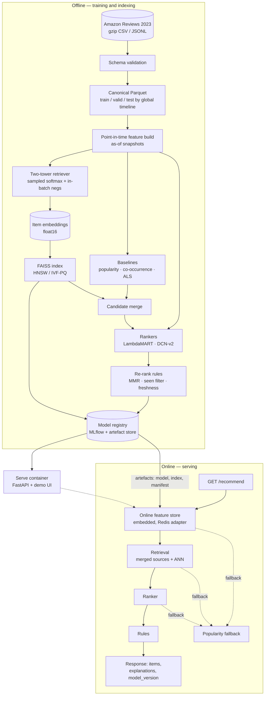

# RankStack — Design Document

| | |
|---|---|
| Status | Draft, awaiting review (Phase 0) |
| Last updated | 2026-10-08 |
| Owner | Pavan Sai Kumar Dangeti |
| Scope | Phases 1–6 of the RankStack roadmap |

---

## 1. Context

RankStack is a recommendation service for an e-commerce catalogue. Given a user, it returns a ranked
list of products the user is likely to want next, a short explanation for each item, and the
identity of the model that produced it.

The system is deliberately shaped like a large platform's recommender rather than a notebook
result:

- **Retrieval** narrows a ~1.6M-item catalogue to a few hundred candidates in a few milliseconds.
  Several independent sources are merged: popularity/recency, item-to-item co-occurrence, implicit
  matrix factorisation, and a two-tower neural retriever.
- **Ranking** orders those candidates with a learned ranker (LambdaMART and a small DCN-v2 are
  compared) over ~25 user/item/context features.
- **Re-ranking** applies business rules: diversity, freshness, and removal of already-seen items.
- **Serving** wraps the whole thing in a latency budget, with a point-in-time-correct feature store,
  observability, and a defined fallback for every failure mode.

The evaluation protocol respects time. Amazon Reviews 2023 is used as interactions with
millisecond timestamps, and every split, feature and metric in this project is defined relative to
a global timeline. A random split is never used, and automated tests fail if any feature can see
data from after the prediction moment.

### 1.1 Why this dataset and not MovieLens

MovieLens-25M is the default choice and therefore the least informative one: ~25M interactions,
~62K items, no product text, no price, no category hierarchy, and a popularity distribution that
makes most ranking problems look solved. RankStack uses **Amazon Reviews 2023 (McAuley Lab)**,
which is large (571.54M reviews, 54.51M users, 48.19M items, 33 categories, May 1996 – Sep 2023),
carries item text and price metadata, and has enough items per category that approximate
nearest-neighbour retrieval is a real engineering problem rather than a `np.argsort`.

---

## 2. Goals and non-goals

### Goals

1. A two-stage retrieval + ranking pipeline with honest baselines that any stage must beat.
2. Time-respecting evaluation with no leakage, reported by user and item segment so that averages
   cannot hide a broken segment.
3. Cold-start handling for both new users and new items, measured separately.
4. An online serving API with a stated latency budget, a point-in-time-correct feature store, and
   graceful degradation instead of errors.
5. Every published number reproducible from a committed script, with the raw result file committed
   under `results/` and the command shown next to it.

### Non-goals

- Real online A/B testing with live users. There is no traffic to randomise.
- Reinforcement-learning recommenders (no live feedback loop to learn from).
- Multi-armed-bandit exploration in production.
- Anything commercially deployed. The dataset's terms do not permit it (see §4.3).

---

## 3. Requirements

### 3.1 Functional

| ID | Requirement |
|---|---|
| F1 | `GET /recommend?user_id&k` returns ranked items with a per-item explanation and `model_version`. |
| F2 | Unknown `user_id` is not an error; the cold-start path returns results. |
| F3 | Already-seen items are never returned. |
| F4 | Explanations are derived from the model's own features/attributions, not generated free-text. |
| F5 | The pipeline is reproducible end to end: raw download → validated Parquet → features → models → index → metrics. |
| F6 | Model and index versions are addressable; every response reports which pair produced it. |
| F7 | `GET /healthz` and `GET /readyz` distinguish liveness from readiness (index and model loaded). |

### 3.2 Non-functional

| ID | Requirement |
|---|---|
| N1 | `mypy --strict` clean, linted and formatted in CI. Pinned versions, committed lockfile. |
| N2 | ≥85% line coverage on `src/rankstack/core`; unit, integration (containerised dependencies), property-based and end-to-end tests. |
| N3 | Structured JSON logs with a request ID on every request. |
| N4 | Prometheus metrics: request rate, error rate, duration histogram, plus domain metrics (fallback rate, feature age, candidate count, score drift). |
| N5 | OpenTelemetry trace export where a request crosses a process boundary; in-process spans always. |
| N6 | Dependency and container scanning in CI. |
| N7 | No secrets in code, logs, images or committed artefacts. |
| N8 | Total run cost $0. Any action with a price tag requires approval first. |

### 3.3 Latency SLOs

Target hardware for the serving measurements: the development Mac (Apple M5, 10 CPU cores, 16 GB
RAM) inside the service container, and a 2 vCPU / 16 GB CPU container as the conservative
free-hosting shape.

| Path | Metric | Target |
|---|---|---|
| Warm user, full pipeline | p50 | ≤ 60 ms |
| Warm user, full pipeline | p95 | ≤ 150 ms |
| Warm user, full pipeline | p99 | ≤ 300 ms |
| Cold-start user | p95 | ≤ 250 ms |
| Degraded (popularity fallback) | p95 | ≤ 20 ms |
| Throughput | sustained | ≥ 100 req/s at 4 vCPU, k=20 |

Budget allocation for the warm path (targets, verified in Phase 5):

| Stage | Budget |
|---|---|
| Online feature fetch | 8 ms |
| Retrieval (merged sources + ANN) | 25 ms |
| Ranking (250 candidates) | 12 ms |
| Re-ranking rules | 5 ms |
| Serialisation, logging, tracing | 10 ms |

These are targets, not results. Phase 5 publishes measured numbers with the load-test command, the
dataset size, and the hardware; if a target is missed, the README says so.

---

## 4. Data

### 4.1 Source

Amazon Reviews 2023, McAuley Lab, UC San Diego. Published at
`https://amazon-reviews-2023.github.io/`. Files are distributed as gzip CSV (`rating_only`) and
gzip JSONL (`raw`, `meta_categories`) from
`https://mcauleylab.ucsd.edu/public_datasets/data/amazon_2023/`.

### 4.2 Category choice

The dataset is split by product category. RankStack uses one primary corpus and one small secondary
corpus:

| Corpus | Users | Items | Interactions | Download (gzip) | Role |
|---|---:|---:|---:|---:|---|
| **Electronics, 0-core** | 18.3M | 1.6M | 43.4M | 970 MB | Primary: training, evaluation, cold start |
| **Electronics, 5-core** | 1.6M | 368.2K | 15.5M | 258 MB | Public-benchmark comparability |
| **Musical Instruments, 5-core** | 57.4K | 24.6K | 511.8K | 8.4 MB | Cross-domain transfer check |
| Electronics item metadata | — | — | — | 1.31 GB | Title, description, price, categories |

Category counts are the publisher's published statistics for the 0-core/5-core files
(verified 2026-10-08); actual row counts are re-derived and asserted in Phase 1, because the
pipeline refuses to run on numbers it has not measured itself.

**Why Electronics.** It is the only category that is simultaneously (a) large enough that ANN
retrieval over ~1.6M vectors is a genuine index problem with a real recall/latency trade-off, and
(b) fast-moving enough that a meaningful fraction of items are new at any evaluation time, which is
what makes the cold-start requirement testable instead of theoretical. It is also rich in the
metadata the item tower needs (title, description, price, hierarchical categories).

**Why not the largest categories.** `Home_and_Kitchen` (66.6M interactions) and
`Clothing_Shoes_and_Jewelry` (65.2M) are bigger, but both are catalogue-dominated: apparel and
home goods have long replacement cycles, low price dispersion and heavy repeat purchase of the same
item, so new-item cold start is rare and the interesting failure modes do not appear. `Automotive`
(19.7M) has strong compatibility/version coupling that is not what this project is about.

**Why 0-core as the primary corpus.** The k-core filter deletes exactly the items a recommender
must handle at launch: an item with fewer than 5 interactions cannot exist in a 5-core corpus, so
cold-start-item evaluation is impossible by construction. The publisher documents this trade-off
directly. The 5-core corpus is still downloaded and used, but only for the external-comparison
protocol in §5.6, where matching the published benchmark matters more than realism.

**Why Musical Instruments as the second category.** It is 8 MB. A whole second domain can be
trained and evaluated in minutes on the Mac, which is enough to show the pipeline is not tuned to
one catalogue and to give a second point on the popularity/coverage trade-off curve.

### 4.3 Terms of use — verified, with a caveat that matters

Verified 2026-10-08 from the publisher's dataset page and from Amazon's Conditions of Use.

- The McAuley Lab release is published for **research use**. The authors state they are "not in a
  position to assign a license to this dataset or dictate the terms of its usage", and make it
  available "primarily for research purposes". It has no explicit licence file; derivatives on the
  Hub carry a "non-commercial academic research use" label by third-party interpretation.
- Amazon's Conditions of Use grant only "personal and non-commercial use", and explicitly exclude
  "any resale or commercial use … any collection and use of product listings, descriptions, or
  prices; any derivative use of any Amazon Service or its contents … or any use of data mining,
  robots, or similar data gathering and extraction tools."

RankStack's position: this is a non-commercial, non-redistributing research and portfolio project
that cites the source, downloads the data at runtime with the publisher's own script, never
commits any dataset file, and never ships dataset content to a third-party API (see ADR-0004). That
is the same use every published recommender paper on this dataset makes. It is not a commercial
deployment, and the project must not become one without re-reviewing the terms.

Mitigations that are enforced in code and CI, not just stated:

1. `data/` is gitignored; CI has a job that fails if any file over 1 MB is added under it.
2. No raw dataset content is included in model artefacts, logs, metrics or the demo UI beyond
   item title/category for items the user actually interacted with.
3. The demo UI displays derived output only; the item text shown is title + category, no
   descriptions, no review text.
4. The citation is in the README and in `docs/design.md`, with the retrieval URLs.

Swapping datasets must stay cheap, so the pipeline is written against a single canonical schema
(`docs/schemas.md`, Phase 1) and category selection is configuration. Yelp Open Dataset (CC BY 4.0)
is the drop-in alternative if the terms ever become a blocker.

### 4.4 Canonical schema and validation

Raw rows (`user_id`, `parent_asin`, `rating`, `timestamp` ms; metadata fields `title`,
`description`, `price`, `categories`, `main_category`, `store`) are validated before anything else
runs. Validation is not a notebook assertion — it is a pipeline stage that fails the build:

| Check | Failure behaviour |
|---|---|
| Column names and dtypes match the expected contract | hard fail |
| `timestamp` parses to UTC and lies in [1996-01-01, 2023-10-01] | hard fail |
| No null `user_id` / `parent_asin` | hard fail |
| Row count within ±2% of the publisher's published statistic | hard fail |
| Duplicate `(user_id, parent_asin, timestamp)` | drop, count reported |
| Same item with conflicting `parent_asin` metadata | keep newest metadata, count reported |
| Items with no title | keep, flagged; title falls back to `main_category` |

Every stage writes Parquet with a schema and a row-count manifest under `data/processed/`. DuckDB
is the single processing engine (SQL over Parquet, streaming from the gzip files, ~1–2 GB peak
RSS on this dataset), so there is exactly one thing to learn, profile and pin instead of two.

---

## 5. Evaluation protocol

This is the part of the project that must be right, because a recommender can be made to look
excellent by leaking the future. The protocol is fixed here, before any model is trained.

### 5.1 Global timeline

The publisher's 0-core corpus already ships an absolute-timestamp split with
`t1 = 1628643414042` (2021-08-11T00:56:54Z) and `t2 = 1658002729837` (2022-07-16T20:18:49Z).

| Partition | Window | Electronics (0-core) interactions |
|---|---|---:|
| Train | `(-inf, t1)` | 35.3M |
| Validation | `[t1, t2)` | 4.0M |
| Test | `[t2, +inf)` | 4.1M |

RankStack re-derives this split in code rather than trusting the shipped files, then asserts that
its row counts match the publisher's published split sizes. If they do not match, the pipeline
fails. This gives both properties: reproducibility from raw data, and a cross-check against an
external artefact.

Additions on top of the global cut:

- **Leave-last-out within the test window**: for each evaluation user, the held-out target is their
  most recent test-window interaction; all other test-window interactions for that user are used
  only for reporting, never as inputs.
- **A "second look" split** one month earlier (`[t2-30d, t2)`) is held out from training entirely
  and used as an untouched scoring set during Phase 3/4 development. Test-window numbers are read at
  most twice per model: once when the model is frozen, once at the end.

### 5.2 Metrics

Ranking metrics at K ∈ {10, 20, 50}, computed over the full candidate catalogue (no sampling —
sampled metrics inflate scores by 1–2 orders of magnitude on a 1.6M catalogue):

| Metric | Definition |
|---|---|
| Recall@K | `|TopK ∩ heldout| / |heldout|` |
| HR@K | 1 if any held-out item is in TopK else 0 |
| NDCG@K | binary-relevance DCG normalised by the ideal ranking |
| MRR@K | reciprocal rank of the first held-out hit |

Beyond-list metrics, because a ranker can win on NDCG while recommending the same 200 popular
items to everyone:

| Metric | Definition |
|---|---|
| Catalogue coverage@K | `|∪_u TopK(u)| / |I|` |
| Intra-list diversity@K | mean pairwise `1 - cos(item_emb)` within each user's TopK |
| Novelty@K | mean self-information `-log p(item)` of recommended items |
| New-item share@K | fraction of recommended items whose first interaction is after `t1` |
| Popularity bias | Gini coefficient of the recommended-item interaction counts |

### 5.3 Segments

Averages hide failures, so every result table is broken out by segment, with `n` shown for each:

| Segment | Definition |
|---|---|
| New user | first interaction in the test window (no usable history) |
| Light user | 2–9 interactions before `t2` |
| Heavy user | ≥ 20 interactions before `t2` |
| New item | first interaction after `t1` (item is unknown at train time) |
| Long-tail item | ≤ 5 interactions in the train partition |
| Category | each `main_category` leaf |

### 5.4 Statistics

- **Bootstrap CIs**: 1000 resamples over users (cluster bootstrap — a user's train and test rows
  must resample together) for every reported metric; 95% percentile intervals.
- **Paired comparison**: paired bootstrap over the same user resamples for the delta between two
  models, with the fraction of resamples favouring each model. A difference whose interval
  straddles zero is reported as "no measurable difference", not as a win.
- **Seeds**: every stochastic stage takes an explicit seed, recorded in the run manifest and in the
  committed result file.

### 5.5 Leakage tests (automated, CI-enforced)

1. **Feature-level**: for a sample of training examples, recompute each feature with the observation
   window truncated one second earlier and assert the value does not change. Any feature that moves
   is reading the future.
2. **Catalogue-level**: assert that no item that has zero interactions in the train partition can be
   ranked for a warm user by a collaborative source (only the content path may surface it, and only
   for cold-start users). Assert the item-tower ID embedding for a new item is *not* used.
3. **Split-level**: assert `max(train.timestamp) < min(valid.timestamp)` and
   `max(valid.timestamp) < min(test.timestamp)` on the actual written Parquet files.
4. **Negative-sampling test**: assert sampled negatives for a training pair are never the user's
   positives at or before the prediction time.
5. **Negative control**: deliberately train a model on a shuffled-time split and assert the leakage
   test suite catches the resulting future information. If the suite passes on a deliberately broken
   pipeline, the suite is wrong.

### 5.6 External comparison

Two things are compared against, with the protocol difference stated every time:

- **Publisher benchmark files**: the Electronics 5-core corpus and the publisher's
  `last_out_w_his` / `timestamp_w_his` splits, scored with the same metric code RankStack uses. Same
  data, same split, so numbers are comparable to published work.
- **Published reference numbers**: BLAIR (arXiv:2403.03952) reports sequential and collaborative
  filtering results on Amazon Reviews 2023 and is the closest public reference for the text-encoder
  choice. Differences in protocol (their leave-last-out single-target setup and their full-ranking
  scoring) are listed next to any number quoted, and no number is presented as "beats paper X"
  unless the protocols actually match.

### 5.7 Offline A/B simulation, and its limits

`rankstack eval replay` re-runs two frozen models as if they were two arms of an experiment:
same user cohort, same prediction moment, same candidate budget, and for each arm the coverage of
the user's actual next interactions within a following window. Reported as lift and coverage
difference with a paired bootstrap interval.

Stated limitations, because this is not a counterfactual estimate:

- No logged propensities exist, so inverse-propensity or doubly-robust estimators are impossible.
- Offline replay conditions on observed behaviour under the *current* policy; it cannot model how a
  new policy would have changed what users did.
- It ignores interference between users and any feedback loop.
- It over-estimates models that happen to align with historical exposure (popularity bias).

It is used only to sanity-check relative ordering of two frozen systems, never to claim a causal
lift.

---

## 6. System design



### 6.1 Candidate generation

Four sources, merged by union-then-rank with a per-source quota so no single source can dominate:

| Source | Signal | Cold-start behaviour |
|---|---|---|
| Popularity + recency | interaction count in a trailing window, decayed | works with zero user history |
| Item-to-item co-occurrence | cosine on the binary interaction matrix, top-k neighbours of the user's last items | needs ≥1 interaction |
| Implicit ALS | `implicit` library, 128 factors, weighted confidence | needs ≥2 interactions |
| Two-tower | user tower over recent history → ANN over item tower | works from 1 interaction; new items via text tower |

Merge policy: each source contributes at most 40% of the final candidate budget, so a recall-oriented
model cannot silently become the system. Fusion is done by rank-fusion (reciprocal rank fusion) at
retrieval time; the learned fusion happens in the ranker, which receives per-source scores and
ranks as features.

### 6.2 Two-tower retriever

- **Item tower**: `e_id = Emb(item)` plus `e_text = MLP(Proj(text_embed(title, description)))`,
  fused by a learned gate and L2-normalised. `text_embed` is a local sentence-transformer
  (Apache-2.0, ~22M parameters), precomputed once and stored float16 (ADR-0004).
- **User tower**: mean-pool of the embeddings of the user's most recent *L* interacted items
  (recency-weighted), optionally plus a small self-attention encoder over the last 20 items. The
  pooling variant is the default; the attention variant is an ablation.
- **Objective**: sampled softmax with log-frequency correction
  (`logits - log(q_i * P(i))`) plus in-batch negatives, temperature 0.05, temperature and
  correction as tunable knobs.
- **Serving**: user vector computed once per request, then a single ANN query.

### 6.3 ANN index

FAISS, two families compared on the same vectors:

- `IndexHNSW` — sweep `M ∈ {16, 32, 64}`, `efConstruction ∈ {100, 200, 400}`, `efSearch ∈ {32…512}`.
- `IndexIVFPQ` — sweep `nlist`, `nprobe`, `m` (PQ sub-quantisers). PQ is also what makes the free
  16 GB hosting shape feasible: 1.6M vectors × 32 bytes ≈ 51 MB, versus 819 MB for float32 at
  128 dims.

Published output: a recall-vs-latency curve per index configuration, where recall is measured
against exact top-200 from a brute-force FAISS search, on a fixed user sample with a fixed seed.
The chosen operating point is recorded in the index manifest with its measured recall and p99.

### 6.4 Ranking

| Model | Why |
|---|---|
| LambdaMART (LightGBM, `lambdarank` objective) | the production default for tabular ranking; strong on small data, fast to serve, exposes feature importances for explanations |
| DCN-v2 (PyTorch) | tests whether cross-features beat trees here; comparable latency budget |

Feature groups (~25 features): per-source retrieval scores and ranks, ALS score, co-occurrence
score, two-tower dot product, item popularity (overall and trailing-window), days since the item's
first/last interaction, user activity and recency stats, category affinity, price affinity and
price percentile, text-similarity to the user's recent items, candidate rank and candidate-source
flags.

### 6.5 Re-ranking rules

- **Seen filter**: hard filter on the user's full interaction set.
- **MMR**: `λ·score - (1-λ)·max_sim(selected, candidates)` with λ = 0.7 default, tuned on the
  validation window only.
- **Freshness boost**: additive bonus decaying with the item's age since first interaction.
- **Category cap**: at most 3 items per leaf category in the top 20 (configurable), which is where
  "10 nearly identical cables" gets fixed.
- Every rule is a pure function of `(candidates, user_context, config)` and is unit-tested against
  hand-computed expectations.

### 6.6 Cold start

- **New user** (no history, or history after `t2`): popularity + recency, blended with content
  similarity to whatever the user has consumed. If literally nothing is known, a curated
  editorial-quality popularity slice is served and the response says so.
- **New item** (first interaction after `t1`): reachable only through the item tower's text side.
  The ID embedding is not trained for it and is masked out at serving time. The evaluation asserts
  that new items are actually being surfaced (new-item share metric, §5.2), not merely that they
  can be.
- Both paths are separately load-tested and separately metered.

### 6.7 Feature store and point-in-time correctness

- **Offline store**: Parquet/DuckDB with an `as_of` column per feature snapshot. A feature row is
  keyed by `(entity, feature_name, as_of)`; the training builder selects the latest snapshot with
  `as_of <= prediction_time`.
- **Online store**: embedded by default — the serving container holds precomputed per-user and
  per-item feature arrays in memory (`float32`, built once at load). This is explicitly permitted by
  the brief and removes a network hop from the latency budget. A Redis (Upstash free tier)
  adapter implements the same interface for the distributed case and is exercised by an integration
  test when credentials are present.
- **Correctness**: the same feature definitions are used offline and online, generated from one
  source of truth (a feature registry), so a "training/serving skew" bug is a type error rather
  than a silent divergence. Skew is additionally detected at load time by recomputing a random
  sample of online features offline and asserting equality within tolerance.
- **Freshness**: `feature_age_seconds` is a feature and a Prometheus gauge; stale data (>24h) raises
  an alert and degrades the model in use.

### 6.8 Serving

`GET /recommend?user_id=<id>&k=<1..50>`:

```
response = {
  user_id, k,
  items: [{ rank, item_id, title, category, price, score,
            explanation: { template, evidence: [...] } }],
  model_version, index_version, retrieved_candidates, fallback_used, served_at
}
```

Explanations are template-based and cite evidence the model actually used, e.g.
"because you reviewed *USB-C Hub 7-port* and *HDMI Adapter* in the last 30 days" or
"similar to *Mechanical Keyboard* which you rated 5". The wording is chosen from a finite set of
templates keyed on which feature dominated, so an explanation is always traceable to a score. No
free-form text is generated at request time (ADR-0003).

### 6.9 Degradation

| Failure | Detection | Behaviour | Metric |
|---|---|---|---|
| Unknown user | miss in user table | cold-start path | `fallback_total{cold_start}` |
| Index unavailable / corrupt | checksum in manifest mismatch | popularity + co-occurrence | `fallback_total{index}` |
| Ranker artefact corrupt | load-time checksum / schema check | rank by retrieval score | `fallback_total{ranker}` |
| Missing or stale online features | age check | feature defaults, log warning | `feature_stale_total` |
| Two-tower scorer throws | exception boundary | drop that source | `fallback_total{retriever}` |
| Traffic spike | queue depth / p99 | shed to `k=10`, then popularity | `shed_requests_total` |
| Online store unreachable | exception boundary | embedded snapshot | `fallback_total{feature_store}` |

Every row of that table is implemented as an exception boundary with a metric and a structured log
line, and each has a test that injects the failure and asserts a 200 response with a non-empty
result list. There is no code path that returns an empty list or a 5xx for a user-facing request.

### 6.10 MLOps

- **Tracking**: MLflow, local file/SQLite backend, tracking server in Docker for team use.
- **Registry**: model versions with stage transitions (`None → Staging → Production`), gated on
  validation metrics and the leakage suite.
- **Index versioning**: `index/{model_version}_{timestamp}/` with `manifest.json`
  (sha256 of every artefact, item-count, dim, index type, measured recall@200, build seconds, seed).
  The serving layer refuses to load an index whose manifest checksum does not match.
- **Rebuild pipeline**: idempotent, resumable, deterministic given (data snapshot, config, seed);
  rebuilds are content-addressed so an unchanged rebuild is a no-op.
- **Model card**: per registered model, auto-generated from the registry: training window, data
  snapshot hash, features, metrics by segment, known failure modes, intended use, and what the
  model must not be used for.

### 6.11 Repository and CI layout

```
rankstack/
  src/rankstack/{data,features,retrieval,ranking,serving,eval,mlops}
  tests/{unit,integration,property,e2e}
  scripts/            # entry points referenced in docs
  results/            # committed raw result files (json/csv), one per published number
  docs/{design.md,adr/,runbook.md,schemas.md}
  infra/              # Grafana dashboards, Prometheus rules, Dockerfiles
```

CI (GitHub Actions, `main` protected, PRs required, these checks required):

| Job | What it enforces |
|---|---|
| `lint` | ruff, formatting, `mypy --strict`, no `# type: ignore` without a code |
| `test` | unit + property tests, coverage gate ≥85% on `core` |
| `integration` | real Redis + real FAISS + real DuckDB via Docker |
| `e2e` | API smoke test + failure-injection suite |
| `security` | `pip-audit`, Trivy image scan, secret scan, large-file guard on `data/` |
| `docs-drift` | every figure in README/design matches the committed file under `results/` |
| `build-images` | builds the two images, publishes nothing |

No workflow may push commits. Dependabot version updates stay off; security alerts stay on.

---

## 7. Alternatives considered

| Decision | Chosen | Rejected | Why |
|---|---|---|---|
| Interaction signal | implicit (any review ≥ threshold) | explicit ratings, purchase proxy | reviews are the only timestamped signal available; ratings as labels would drop 60% of rows and add little for ranking |
| Processing engine | DuckDB | Polars, Spark, plain pandas | one engine is enough at 43M rows; Spark is not runnable on 16 GB; Polars would be a second thing to pin and profile |
| Two-tower objective | sampled softmax + logQ correction, in-batch negatives | full softmax over 1.6M items, BPR | full softmax is 1.6M logits/step (too slow on free GPUs); BPR ignores the popularity prior and is much weaker on this data |
| User tower | recency-weighted mean pool (default) | small Transformer over history | mean pool trains in minutes on a free GPU and is a hard baseline to beat; the attention variant is the ablation |
| Text encoder | local sentence-transformer, ~22M params | hosted embedding API | cost, rate limits, and sending catalogue text to a third party (ADR-0004) |
| Ranker | LambdaMART + DCN-v2 compared | single deep ranker, heuristic blend | the comparison is the deliverable; a heuristic blend cannot be a fair baseline for a learned ranker |
| Online feature store | embedded, Redis adapter behind one interface | Upstash Redis as primary | 500K commands/month free tier is the binding limit; a demo cannot depend on it. Interface kept so the distributed case is one adapter, not a rewrite |
| Hosting | single HF Space container (2 vCPU/16 GB CPU Basic) | Render free (512 MB, 15-min spin-down), Oracle Always Free VM | Render's 512 MB cannot hold a float32 index and its spin-down makes a demo look broken; two deployment targets is worse than one good one |
| Split | global timeline, publisher's `t1`/`t2` | leave-last-out only, random | leave-last-out alone still leaks across users; random split is not a defensible number |
| Corpus | Electronics 0-core | Electronics 5-core only | 5-core deletes all cold-start items (§4.2) |

---

## 8. Risks

| Risk | Impact | Mitigation |
|---|---|---|
| Dataset terms are read strictly | project unusable | non-commercial use only, no redistribution (enforced), dataset-agnostic schema with a CC-licensed swap-in (§4.3) |
| Free GPU time is unpredictable | long runs die mid-training | checkpoint every N steps, resume from checkpoint, all runs resumable and seeded; Mac CPU/MPS is the guaranteed fallback |
| LLM API free tiers change or throttle | long analysis jobs fail | no LLM in the online path; offline LLM use is optional, rate-limit aware, resumable, and cost-reported as a list-price estimate |
| Free hosting sleeps or is paused | demo link shows an error | Space serves a cached static shell; README documents expected cold-start delay; verified live before the release tag |
| Two-tower underperforms the baselines on this corpus | weak headline result | that is a legitimate finding, reported as-is; ALS + co-occurrence + two-tower are merged anyway, so the system does not depend on one retriever |
| 43M interactions on 16 GB RAM | OOM, long runtimes | DuckDB streaming, chunked processing, faiss PQ for serving, explicit memory budgets in the pipeline config |
| Evaluation gets tuned by repeated peeking | dishonest numbers | held-out "second look" window, test read at most twice, CI test that result files match docs |
| Annoying-but-real scope creep | phases overrun | non-goals are explicit (§2); each phase ships one PR |

---

## 9. Threat model

Scope: the serving API, the demo UI, the CI pipeline, the model/index artefact store, and the local
dataset cache. Adversaries: an unauthenticated internet user hitting the public demo, a
compromised dependency, and an accidental insider (a well-meaning future contributor).

| Asset | Threat (STRIDE) | Mitigation |
|---|---|---|
| Serving API | Spoofing / tampering of `user_id` | opaque user IDs only, strict pydantic validation, `k` clamped to 1..50, length limits on every parameter |
| Serving API | DoS via request floods | per-IP token bucket, global concurrency cap, `k` cap, query timeout, response-size cap, shed-to-popularity under load |
| Serving API | Information disclosure of internal state | generic error bodies, stack traces only in logs, model/index paths never in responses |
| User interaction data | Privacy: user IDs are pseudonymous but linkable | no raw review text in logs or responses, PII-field allowlist on every log call, retention: logs 7 days |
| Model artefacts | Tampering (poisoned index or model swapped in) | sha256 manifest verified at load, artefacts written read-only, promotion requires the leakage suite to pass |
| Training pipeline | Data poisoning | dataset schema validation + row-count assertions; a poisoned corpus fails validation before it reaches a model |
| Item text → explanations | Prompt injection / injection via catalogue text | no LLM in the serving path (ADR-0003); explanations are template + evidence only, and item text is escaped on render |
| Third-party LLM APIs | Data exfiltration | no dataset content is sent to any external API (ADR-0004); outbound calls only in offline analysis jobs, keys in environment only |
| Dependencies | Supply-chain compromise | pinned lockfile, `pip-audit`, Dependabot security alerts, Trivy image scan, minimal container base images |
| CI | Secret leakage, bot-authored commits | secrets from environment only, no push-capable workflows, no auto-commit automation |
| Docker images | Privilege escalation | non-root user, read-only root filesystem where possible, dropped capabilities, no embedded credentials |
| Local dataset cache | Accidental commit of restricted data | `data/` gitignored + CI large-file/extension guard |
| Demo UI | XSS from item titles | output escaping, `Trusted`/no-raw-HTML components, CSP header |

Out of scope for v1: authentication/authorisation of the recommendation API (there are no real
users; the demo is public and read-only by design), and multi-tenancy.

---

## 10. Budget, compute and hosting plan

Everything below is free tier only. Any action that could incur cost requires explicit approval
first.

### 10.1 Compute

| Stage | Where | Why |
|---|---|---|
| Data pipeline, baselines, evaluation, index build, load tests | Apple M5, 16 GB, Docker | always available, no queue, 43M rows fits |
| Two-tower + DCN-v2 training | Colab free T4, with Kaggle free GPU as fallback | free tier gives 12 h max runtime with unpublished, fluctuating limits → every run checkpoints and resumes |
| Anything that must not fail | Mac (CPU/MPS) | guaranteed path; a free GPU is an accelerator, not a dependency |
| Reproducibility runs | CPU-only Docker image | must produce identical results to the GPU path within documented tolerance |

Verified 2026-10-08 that macOS arm64 wheels exist for the pinned scientific stack
(`faiss-cpu` 1.15.1, `implicit` 0.7.3, `lightgbm` 4.7.0, `duckdb` 1.5.6, `torch` 2.14.1), so no
Rosetta or x86 emulation is required.

### 10.2 Hosting

| Piece | Service | Limits (verified 2026-10-08) |
|---|---|---|
| Demo UI + API | Hugging Face Space, CPU Basic, Docker SDK | 2 vCPU, 16 GB RAM, 50 GB non-persistent disk, free; sleeps after 48 h idle and wakes on visit |
| Online feature store | Embedded in the container; Upstash Redis adapter | Upstash free: 256 MB, 500K commands/month, 10 GB bandwidth |
| Model tracking | MLflow in a local Docker container, SQLite/file backend | free; artefacts in the repo's `artifacts/` (gitignored) and attached to releases |
| Dashboards | Committed Grafana JSON + Prometheus rules; metrics exposed on `/metrics` | free; no hosted Grafana needed |

Caveats taken into account rather than discovered later:

- HF's docs note that creating a Space that *runs* compute requires a paid plan, while the pricing
  page lists CPU Basic as free. This is the first thing to verify in Phase 6; if it blocks, the
  fallback is a static Space that calls a Render free API (accepting the 15-minute spin-down and the
  512 MB memory ceiling, which is why the serving index is PQ-compressed).
- Upstash's 500K commands/month free tier is the reason the embedded store is the default rather
  than the fallback.

### 10.3 LLM API budget

`NVIDIA_API_KEY` and `GEMINI_API_KEY` live in a gitignored `.env`. They are used only for optional
offline analysis (for example LLM-generated item aspect summaries as an ablation, or narrative
summaries of evaluation segments). Nothing in retrieval, ranking, serving or the demo depends on
them.

Rate limits are per-project, unpublished, and change without notice, so any job that uses them must
be rate-limit aware (token bucket, exponential backoff on 429) and resumable (per-item state file,
idempotent writes). Model cost is reported as a list-price estimate: measured token counts × a named
provider's published price, with the price URL and the date. Actual spend is $0.

---

## 11. Phase plan

| Phase | PR contents | Stop point |
|---|---|---|
| 0 | This document, ADRs, repo hygiene | **review** |
| 1 | Repo layout, CI, schema validation, point-in-time data pipeline, leakage test harness | review |
| 2 | Popularity, co-occurrence, ALS; full evaluation harness with metrics, segments, bootstrap | review |
| 3 | Two-tower retriever, FAISS HNSW vs IVF-PQ, recall/latency curves | review |
| 4 | LambdaMART vs DCN-v2, re-ranking rules, cold start, segment analysis | review |
| 5 | Serving API, feature store, load tests, observability, failure-injection suite, runbook | review |
| 6 | Demo deployment, demo GIF/video, README results table, ADRs, `v1.0.0` release | final |

---

## 12. Open questions for review

1. **Dataset terms** (§4.3): confirm you are comfortable shipping a non-commercial research project
   built on a dataset Amazon's Conditions of Use do not clearly license for this purpose, with the
   mitigations above. The alternative is switching the default corpus to a permissively licensed
   dataset (Yelp Open Dataset, CC BY 4.0) at the cost of losing price metadata and some scale.
2. **Corpus size** (§4.2): Electronics 0-core at 43.4M interactions / 1.6M items is the heavy end
   of what a 16 GB Mac handles comfortably. Fallback is the 5-core corpus (15.5M / 368K), which is
   lighter and still a serious dataset, at the cost of a weaker cold-start story.
3. **Second category** (§4.2): Musical Instruments (8 MB) is proposed as the transfer check rather
   than a second large category. A second large category roughly doubles phase 1 and 2 runtime for
   little additional signal.
4. **Latency targets** (§3.3): p95 ≤ 150 ms for the full warm path. If you want a tighter production
   story, the honest lever is a smaller candidate budget, not a faster machine.
5. **Demo hosting** (§10.2): confirm Hugging Face Space as the primary, with the static-UI +
   Render-API fallback if HF's paid-plan requirement for compute Spaces blocks the free tier.

---

## Appendix A — External references

| Reference | Used for |
|---|---|
| Amazon Reviews 2023 (McAuley Lab), `https://amazon-reviews-2023.github.io/` | dataset, published statistics, benchmark splits |
| Amazon Conditions of Use, `https://www.amazon.com/gp/help/customer/display.html?nodeId=GLSBYFE9MGKKQXXM` | terms analysis (§4.3) |
| BLAIR, arXiv:2403.03952 | external comparison for text encoders on Amazon Reviews 2023 (§5.6) |
| Ji, Sun, Zhang, "A Critical Study on Data Leakage in Recommender System Offline Evaluation", ACM TORS 2023 | rationale for global-timeline evaluation (§5.1) |
| Rendle et al., "BPR" (2009); Hu, Koren, Volinsky, "Collaborative Filtering for Implicit Feedback Datasets" (2008) | baseline definitions |
| Chapelle et al., "Simple and Scalable Predictive Accuracy Estimation" / two-tower retrieval literature | sampled softmax with logQ correction (§6.2) |
| Carbonell & Goldstein, MMR (1998) | diversity re-ranking (§6.5) |
| Google Cloud, "Training and serving machine learning models with point-in-time correctness" | feature-store design (§6.7) |